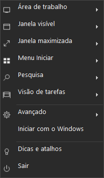
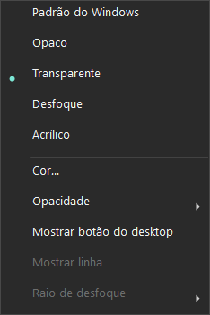

# TaskBAR

Aplicativo portátil x64 para personalizar a barra de tarefas do Windows. A interface principal é um menu compacto na bandeja, em português, inspirado no fluxo do TranslucentTB.

**Versão 0.3.0 · Windows x64 · C# / .NET Framework 4.8 · GPL-3.0**

<p>
  
  
</p>

## Recursos

- Transparência em todos os estados como configuração inicial.
- Efeitos Padrão do Windows, Opaco, Transparente, Desfoque e Acrílico.
- Cor e opacidade por perfil, com seleção por monitor.
- Regras por processo, classe da janela ou trecho do título.
- Presets que preservam regras e exclusões personalizadas.
- Editor visual e JSON abertos somente quando solicitados.
- Inicialização no login, pausa e restauração da aparência original pelo menu.

## Começar pelo código-fonte

Execute no PowerShell, em um Windows x64 com .NET Framework 4.8:

```powershell
git clone https://github.com/Thalysx/TASKbar.git
cd TASKbar
powershell.exe -NoProfile -ExecutionPolicy Bypass -File .\build.ps1
.\dist\TaskBAR-0.3.0\TaskBAR.exe
```

O build usa o compilador do .NET Framework instalado no Windows, sem restauração de pacotes NuGet. Para uso portátil, copie **toda a pasta** `dist/TaskBAR-0.3.0/` para um local permanente com permissão de gravação. Mantenha `ExplorerTAP.dll` e os demais arquivos ao lado do executável.

## Usar

Execute `dist/TaskBAR-0.3.0/TaskBAR.exe` ou a instalação fixa em `%LOCALAPPDATA%\TaskBAR\TaskBAR.exe`. O aplicativo inicia pela bandeja e aplica seus perfis quando a barra estiver disponível. A entrada de início automático usa `--startup`; o comportamento pela bandeja também é o padrão ao abrir manualmente.

A pasta `%LOCALAPPDATA%\TaskBAR` é uma opção de destino permanente; o build não faz essa instalação automaticamente.

Clique com o botão esquerdo ou direito no ícone. O menu apresenta:

- Área de trabalho, janela visível, janela maximizada, Iniciar, Pesquisa e Visão de tarefas.
- Em cada submenu: efeito, cor, opacidade, habilitação do perfil e controles disponíveis para aquela versão da barra.
- Avançado: economia de bateria, presets, regras, editor completo, JSON e pausar/restaurar o Windows.
- Iniciar com o Windows: ativa ou desativa a entrada de execução no login para o executável atual.
- Dicas e atalhos e Sair.

As mudanças feitas pelo menu são salvas automaticamente. Opacidade ajusta o alfa sem alterar o RGB. Opaco força alfa total; Padrão do Windows restaura o fundo do sistema. Em Avançado, presets alteram os perfis gerais e preservam as regras personalizadas.

Sair restaura a aparência original e encerra o controlador. Se o TranslucentTB estiver aberto, o TaskBAR aguarda sua saída antes de aplicar efeitos. Não encerra outros programas automaticamente. Uma segunda instância do TaskBAR sai silenciosamente.

### Iniciar com o Windows

Depois de colocar o aplicativo na pasta definitiva, marque **Iniciar com o Windows** no menu. O TaskBAR registra o executável atual na chave `Run` do usuário e passa a iniciar silenciosamente no próximo login. Desmarque a opção para remover a entrada. Se mover a pasta, desmarque antes e ative novamente no novo local.

## Configuração avançada

O editor completo continua acessível em Avançado. Ele é iniciado sob demanda em um processo separado, sem outro ícone de bandeja nem controlador de efeitos. O aplicativo principal carrega suas alterações salvas automaticamente. Enquanto o editor estiver aberto, as alterações dos perfis pelo menu ficam desabilitadas para evitar gravações concorrentes. Feche o editor para voltar aos ajustes pelo menu.

Os arquivos ficam em `data/settings.json` e `data/taskbar.log`, junto ao executável. Gravações atômicas mantêm `settings.json.bak`. JSON inválido preserva a última configuração válida. `disable_saving` aplica mudanças à sessão sem gravar. O log fica limitado a 1 MB.

O parser aceita comentários e vírgulas finais, incluindo o formato exemplificado em [tests/fixtures/translucenttb-settings.json](tests/fixtures/translucenttb-settings.json). A compatibilidade de importação é parcial: metadados e opções não implementadas, como `$schema`, idioma e tipo de menu, não são preservados na exportação. Regras usam classe, executável e trecho do título, com aparência inativa opcional. Processos não diferenciam maiúsculas; títulos usam substring e diferenciam maiúsculas.

Prioridade: bateria, Visão de tarefas, Aero Peek, Iniciar, Pesquisa, maximizada, janela visível e desktop. Apenas a maximizada superior na ordem Z é consultada para regras. Regras visíveis só consideram a janela em primeiro plano quando não há maximizada no monitor. Iniciar aberto exclui Pesquisa mesmo se seu perfil estiver desabilitado.

## Compatibilidade

Requer Windows x64, .NET Framework 4.8 e permissão de gravação na pasta do aplicativo. A validação local foi realizada no Windows 10, build 19045. O backend clássico usa SetWindowCompositionAttribute; o backend moderno usa o serviço XAML do ExplorerTAP. Linha e raio personalizado ficam desabilitados no menu quando o backend disponível não oferece esses controles. O botão do desktop é configurado no caminho clássico; ocultá-lo preserva o clique.

Pesquisa é reconhecida pelos processos SearchHost/SearchApp/SearchUI. Iniciar usa IAppVisibility com complemento pelo processo em primeiro plano. A detecção de Visão de tarefas pela classe MultitaskingViewFrame continua provisória em versões recentes do Windows 11. O backend XAML não foi validado nesta máquina Windows 10.

Capturas de janelas respondem a eventos, com agrupamento de eventos em sequência. Na ausência de eventos, ocorrem a cada dois segundos com efeitos habilitados e cinco segundos quando pausado. Há cache de processos e do tipo de barra. Pausar invalida operações pendentes; mudanças do PID do Explorer descartam os handles e o estado antigos.

## Código e licença

O código em `src/` contém menu, configuração, seleção de perfis, observação e renderização próprios. A versão moderna reutiliza `ExplorerTAP.dll` do TranslucentTB 2026.2, SHA-256 `c48f1a06168acd7839269dde0d15ccf5d09c702512b94dd6ba9a05df1b153dc2`, do commit `d4636e439865df0a1a1419db408e055740ce5c74`. O aplicativo não executa TranslucentTB.exe.

O TaskBAR é disponibilizado sob [GPL-3.0](LICENSE.md). Licenças e créditos estão em [THIRD_PARTY.md](THIRD_PARTY.md) e na [licença do componente](vendor/LICENSE-TranslucentTB.md). O fonte da ponte está em `vendor/TranslucentTB-d4636e4-source.zip`. O pacote portátil contém também o código-fonte do TaskBAR.

## Compilar e verificar

```powershell
powershell.exe -NoProfile -ExecutionPolicy Bypass -File .\build.ps1
```

O parâmetro afeta somente esse processo do PowerShell. O build usa o compilador .NET Framework local, sem NuGet. Resultados e imagens em `artifacts/0.3.0/`. O menu pode ser renderizado por `--tray-preview`; `--tray-smoke` testa a estrutura e as ações em uma configuração isolada, sem aplicar efeitos à barra. `--settings-smoke` verifica que o editor não cria outro controlador. `--diagnose` e `--benchmark` são diagnósticos somente leitura.

O menu e o editor foram verificados estaticamente e em testes isolados. O teste da bandeja não altera a barra real. A compatibilidade visual de efeitos no Windows 11 exige validação nessa plataforma.

A versão 0.3.0 passou em **46 verificações do motor**, **seis do menu** e **duas do editor avançado**. Para executar os testes após compilar:

```powershell
$taskExe = Join-Path $PWD 'dist\TaskBAR-0.3.0\TaskBAR.exe'
foreach ($taskMode in @('self-test', 'tray-smoke', 'settings-smoke')) {
    $taskReport = Join-Path $PWD ('artifacts\0.3.0\' + $taskMode + '.txt')
    $taskProcess = Start-Process -FilePath $taskExe -ArgumentList @('--' + $taskMode, ('"' + $taskReport + '"')) -Wait -PassThru
    if ($taskProcess.ExitCode -ne 0) { throw ('Falhou: ' + $taskMode) }
    Get-Content -LiteralPath $taskReport
}
```

Para gerar o pacote portátil com código-fonte, execute depois da compilação e dos testes acima:

```powershell
powershell.exe -NoProfile -ExecutionPolicy Bypass -File .\package.ps1
```

O resultado fica em `release/TaskBAR-0.3.0-win-x64.zip`.

## Organização do projeto

| Caminho | Responsabilidade |
| --- | --- |
| `src/CompactTrayMenu.cs`, `src/TrayController.cs` | Menu da bandeja e ciclo de execução. |
| `src/Configuration.cs`, `src/Policy.cs` | Configuração, validação e seleção dos perfis. |
| `src/WindowsNative.cs`, `src/Renderer.cs` | Observação do Windows e aplicação dos efeitos. |
| `src/MainWindow*`, `src/RulesPage.xaml` | Editor avançado e interface de regras. |
| `tests/` | Configuração de exemplo usada nos testes. |
| `vendor/` | Ponte ExplorerTAP, licença e fonte correspondente. |
| `build.ps1`, `package.ps1` | Compilação, verificação e empacotamento. |

Veja o [histórico de versões](CHANGELOG.md) para as mudanças de cada versão.
